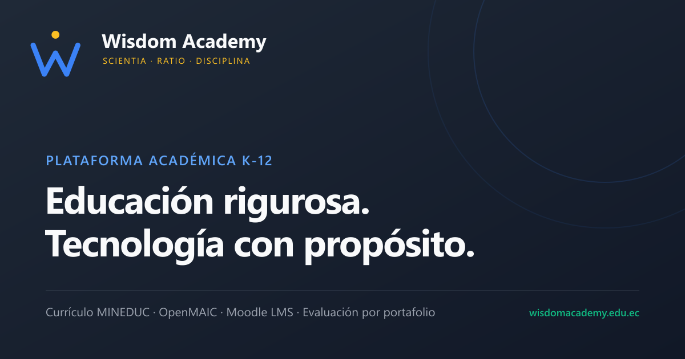
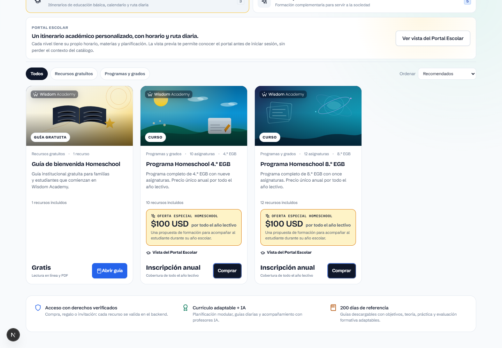
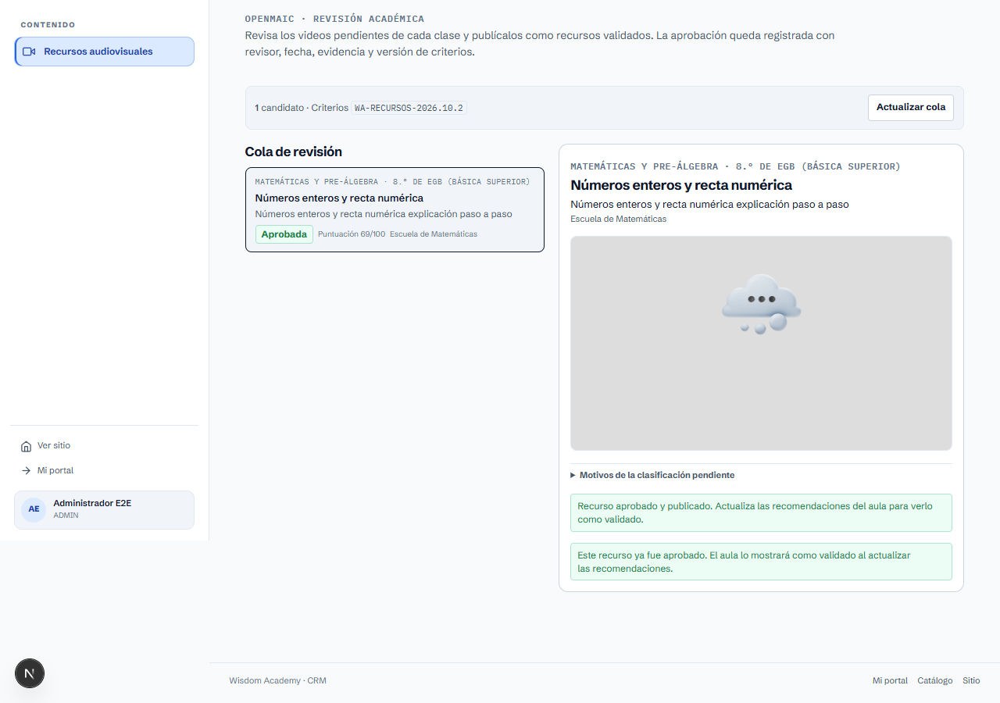
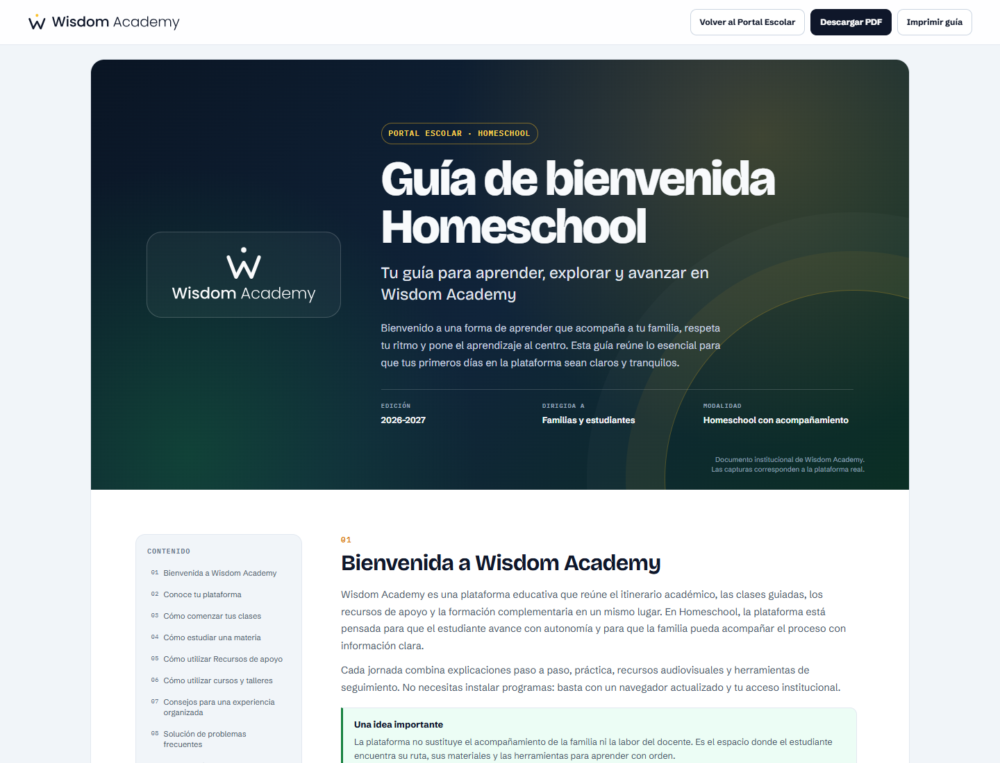
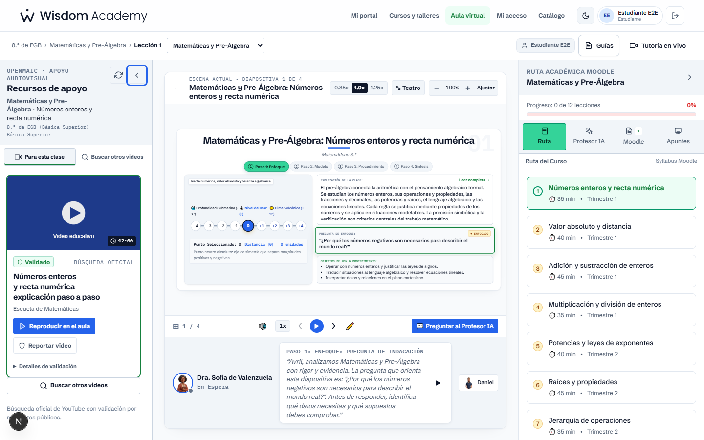
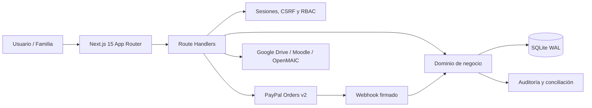

<p align="center">
  
</p>

<h1 align="center">Wisdom Academy</h1>

<p align="center">
  Plataforma educativa integral para educación básica, homeschool, cursos y talleres.<br />
  Catálogo, matrículas, aula virtual, administración académica y pagos con PayPal.
</p>

<p align="center">
  <a href="https://nextjs.org/"></a>
  <a href="https://react.dev/"></a>
  <a href="https://www.typescriptlang.org/"></a>
  <a href="https://nodejs.org/"></a>
  <a href="https://www.sqlite.org/"></a>
  <a href="https://developer.paypal.com/"></a>
  
  
</p>

<p align="center">
  <a href="https://github.com/rpmministry/wisdom-academy-platform/actions/workflows/ci.yml"></a>
</p>

---

## Estado del proyecto

| Área | Estado |
|---|---|
| Aplicación web, catálogo y aula virtual | Operativo en desarrollo |
| Base de datos SQLite con migraciones | Operativa; 8 migraciones versionadas |
| PayPal Sandbox | **Verificado con pago real de Sandbox** el 23/10/2026 |
| PayPal Live | **No activado**; requiere autorización y verificación comercial |
| Hosting recomendado | Host Node con volumen persistente (Northflank, VPS u Oracle Free) |
| Vercel | **No soportado con SQLite**; requiere migrar a Turso/PostgreSQL |
| Dominio propio | Pendiente; la guía de despliegue incluye el procedimiento |

> **Importante:** no se debe desplegar esta versión en Vercel Production con SQLite. El sistema de archivos de Vercel Functions no es persistente y los usuarios, pagos y accesos se perderían. Ver [docs/DEPLOY_FREE_HOSTING.md](docs/DEPLOY_FREE_HOSTING.md).

## Vista del producto

| Catálogo público | Panel administrativo |
|---|---|
|  |  |

| Guía de bienvenida | Recursos educativos |
|---|---|
|  |  |

## Funcionalidades

### Experiencia pública

- Página de inicio, propuesta académica y catálogo de cursos, talleres y programas.
- Catálogo responsive con filtros, orden, precios, disponibilidad y estado de precio.
- Encabezado público compartido, carrito con contador y menú de cuenta accesible en móvil, tableta y escritorio.
- Carrito persistente para varios productos con retirada, subtotal y continuidad al checkout.
- Checkout con login integrado (sin perder el carrito), cotización del servidor, códigos de descuento y PayPal Sandbox/Live.
- Guía de bienvenida descargable y recursos de acceso gratuito.
- Página de retorno que confirma la captura en el servidor, nunca por el navegador.
- Perfil `/mi-cuenta` con identidad, accesos e historial de compras.

### Aula virtual y academia

- Cursos y programas con módulos, lecciones, materiales y semanas.
- Evaluaciones, intentos, calificaciones, repasos y certificados.
- Progreso del estudiante, calendario, reuniones semanales y entregas.
- Recursos educativos con validación, revisión y recomendaciones.
- Aula OpenMAIC y orquestación de IA para experiencias de aprendizaje.
- Portal del estudiante y panel del representante.

### Administración y CRM

- Usuarios, roles, permisos RBAC y sesiones revocables.
- Productos, precios, moneda, publicación y recursos incluidos.
- Órdenes, capturas, reembolsos y conciliación.
- Módulo financiero dentro del CRM: cobros, neto, pendientes, fallos, evolución, productos, códigos, detalle y CSV, con permiso `orders.read`.
- Códigos de descuento, regalos, invitaciones y accesos globales.
- Año lectivo, matrículas, calificaciones y reportes.
- Auditoría de acciones administrativas y panel de resumen.

### Pagos

- API Orders v2 de PayPal mediante `fetch` del servidor.
- Precio y moneda calculados exclusivamente en el backend.
- Órdenes vinculadas a usuario, producto y referencia de PayPal.
- Captura idempotente y recuperación de respuestas perdidas.
- Webhooks firmados con verificación oficial, deduplicación y auditoría.
- Reembolsos completos, parciales, pendientes y reversiones.
- Productos con precio pendiente bloqueados en catálogo y checkout.
- Verificación Sandbox real: orden, captura, acceso, matrícula y webhook procesados una sola vez.

### Seguridad y operación

- Sesiones `HttpOnly`, CSRF en mutaciones y límites de frecuencia.
- RBAC en rutas administrativas y validación de propiedad de órdenes.
- Escaneo de secretos en fuente y artefactos compilados.
- Migraciones idempotentes, backup/restore y `PRAGMA integrity_check`.
- Healthcheck público `GET /api/health`.
- Documentación de riesgos, aceptación y despliegue.

## Arquitectura



### Stack

| Capa | Tecnología |
|---|---|
| Framework | Next.js 15.5 (App Router) |
| UI | React 18.3, TypeScript 5.7, CSS propio |
| Runtime | Node.js 24 |
| Persistencia | SQLite con `node:sqlite`, WAL y migraciones versionadas |
| Pagos | PayPal Orders v2, OAuth 2.0 y webhooks |
| Pruebas | Node Test Runner, Playwright y servidor PayPal simulado |
| Documentos | Generación PDF, guías y reportes |
| Integraciones | Google Drive, Moodle, YouTube, OpenMAIC y orquestación IA |

## Inicio rápido

### Requisitos

- Node.js 24 (`>=24 <25`)
- npm 10 o superior
- Git

### Instalación

```bash
git clone https://github.com/rpmministry/wisdom-academy-platform.git
cd wisdom-academy-platform
npm ci
```

### Variables de entorno

Copia el ejemplo y completa solo los valores necesarios:

```bash
cp .env.example .env.local
```

Mínimo para desarrollo local:

```dotenv
APP_URL=http://localhost:3000
WISDOM_DB_PATH=.data/wisdom.db
WISDOM_BACKUP_DIR=.data/backups
PLATFORM_OWNER_EMAIL=tu-correo@dominio.com
CODE_HASH_PEPPER=un-secreto-largo
WISDOM_RATE_LIMIT_SALT=otro-secreto-largo
```

Para cobros Sandbox, añade las variables de `PAYPAL_*` documentadas en [docs/PAYPAL_SETUP.md](docs/PAYPAL_SETUP.md). **Nunca** uses `NEXT_PUBLIC_PAYPAL_CLIENT_SECRET` ni subas `.env` al repositorio.

### Arranque

```bash
npm run dev
```

Abre `http://localhost:3000`. La aplicación aplica las migraciones y la semilla de forma idempotente al inicializar la base.

### Propietario de la plataforma

La semilla no crea la cuenta del propietario. Provisiona la cuenta de forma segura:

```bash
npm run provision:owner
```

El comando genera una contraseña inicial y la guarda en un archivo protegido. Cambia la contraseña al iniciar sesión.

## Base de datos

| Comando | Función |
|---|---|
| `npm run db:backup` | Respaldo consistente de SQLite |
| `npm run db:restore -- --from RUTA --confirm` | Restauración explícita |
| `npm run check:deploy` | Verificación previa al despliegue |

La base de producción debe vivir en un volumen persistente, por ejemplo:

```text
WISDOM_DB_PATH=/data/wisdom.db
WISDOM_BACKUP_DIR=/data/backups
```

No uses el disco efímero de una función serverless.

## Programa de Teología N2N

El programa de Teología se importa con:

```bash
npm run import:n2n-semester-1
```

El importador es idempotente y publica el Semestre 1 con clases, materiales, repasos y evaluaciones. El producto queda activo en el catálogo a **USD 50 por semestre**. En la imagen Docker el importador se ejecuta automáticamente la primera vez (`RUN_N2N_IMPORT=1`) y deja un marcador persistente en `/data`.

## Pruebas

```bash
npm run typecheck
npm run test:payments
npm test
npm run test:e2e
npm run check:secrets
```

Resultados de la sesión de validación:

| Comando | Resultado |
|---|---|
| `npm test` | **174 aprobadas, 0 fallos** |
| `npm run test:platform` | **71 aprobadas, 0 fallos** |
| `npm run test:payments` | **28 aprobadas, 0 fallos** |
| Playwright (suite completa) | **50 aprobadas, 0 fallos** |
| `npm run build` | Correcto, 19 páginas prerenderizadas |
| PayPal Sandbox real | Orden `3TY92249470992444`, captura `9S879207H39589335`, `10.00 USD` (evidencia del 23/10/2026) |

Los detalles y evidencias están en [docs/PAYPAL_TESTING.md](docs/PAYPAL_TESTING.md).

## Despliegue

### Opción recomendada

Host Node con volumen persistente. La guía gratuita incluye Northflank Sandbox y Oracle Cloud Always Free:

- [docs/DEPLOY_FREE_HOSTING.md](docs/DEPLOY_FREE_HOSTING.md)
- `Dockerfile` listo para construir la imagen.
- Healthcheck: `GET /api/health`.
- Volumen: `/data`.

### Vercel

No es compatible con SQLite persistente y el plan Hobby está restringido a uso personal/no comercial. Para Vercel se requiere:

1. Migrar a Turso/libSQL, Neon o Supabase.
2. Convertir la capa de datos a asíncrona.
3. Usar un plan compatible con uso comercial.

Ver [docs/PAYPAL_DEPLOYMENT.md](docs/PAYPAL_DEPLOYMENT.md).

## Estructura del repositorio

```text
.
├── src/
│   ├── app/                 # Páginas y Route Handlers de Next.js
│   ├── components/          # UI de catálogo, LMS, CRM y administración
│   ├── server/              # Dominio, auth, DB, pagos y HTTP
│   ├── lib/                 # Clientes, utilidades e integraciones
│   ├── styles/              # Sistema visual y estilos
│   └── data/                # Currículo y datos base
├── tests/                   # Unitarias, integración, plataforma y E2E
├── scripts/                 # Migraciones, backups, provisión y checks
├── docs/                    # Arquitectura, PayPal, despliegue y auditoría
├── public/                  # Marca, fuentes, imágenes y documentos
├── Dockerfile
├── next.config.ts
└── package.json
```

## Documentación

| Documento | Contenido |
|---|---|
| [docs/PAYPAL_AUDIT.md](docs/PAYPAL_AUDIT.md) | Auditoría técnica y decisiones de PayPal |
| [docs/PAYPAL_SETUP.md](docs/PAYPAL_SETUP.md) | Cuenta, credenciales, webhook y variables |
| [docs/PAYPAL_TESTING.md](docs/PAYPAL_TESTING.md) | Pruebas, evidencias Sandbox y pendientes |
| [docs/PAYPAL_DEPLOYMENT.md](docs/PAYPAL_DEPLOYMENT.md) | Producción, rollback y seguridad |
| [docs/DEPLOY_FREE_HOSTING.md](docs/DEPLOY_FREE_HOSTING.md) | Hosting gratuito con volumen persistente |
| [docs/PAYPAL_ACCEPTANCE.md](docs/PAYPAL_ACCEPTANCE.md) | Condiciones de aceptación y evidencias |
| [docs/CHECKOUT_Y_CRM_FINANCIERO.md](docs/CHECKOUT_Y_CRM_FINANCIERO.md) | Carrito, checkout, permisos y módulo financiero del CRM |
| [docs/UX_PORTALES_Y_NAVEGACION.md](docs/UX_PORTALES_Y_NAVEGACION.md) | Encabezados responsive, perfil y patrones de navegación |
| [docs/ARCHITECTURE.md](docs/ARCHITECTURE.md) | Arquitectura, módulos, datos y flujo de pagos |

## Seguridad

- No publiques vulnerabilidades en issues abiertos.
- No incluyas credenciales, tokens, cookies ni datos de estudiantes en reportes.
- Usa [SECURITY.md](SECURITY.md) para el procedimiento de reporte.
- Ejecuta `npm run check:secrets` antes de publicar cambios.

## Contribuir

Lee [CONTRIBUTING.md](CONTRIBUTING.md). Las contribuciones deben:

1. Respetar la arquitectura y el modelo de permisos.
2. Incluir pruebas para cambios de pagos, accesos o datos.
3. No introducir secretos ni dependencias innecesarias.
4. Pasar `npm run typecheck`, `npm test` y `npm run build`.
5. Mantener el tono, la accesibilidad y el diseño responsive.

## Roadmap

- [x] Catálogo, aula virtual y administración.
- [x] PayPal Sandbox con captura y webhook reales.
- [x] Idempotencia, conciliación y reembolsos parciales.
- [ ] Pago Live con cuenta comercial verificada.
- [ ] Dominio propio y hosting de producción con SLA.
- [ ] Migración evaluada a Turso/PostgreSQL para Vercel.
- [ ] Monitorización externa y alertas de conciliación.
- [ ] Ampliación de pruebas E2E de checkout en Sandbox.

## Licencia

**Propietario.** Copyright © 2026 Wisdom Academy. Todos los derechos reservados. No se concede permiso de uso, copia, modificación o distribución sin autorización escrita del propietario. Ver [LICENSE](LICENSE).

---

<p align="center">
  <strong>Wisdom Academy</strong><br />
  Educación con propósito, tecnología con integridad.
</p>
