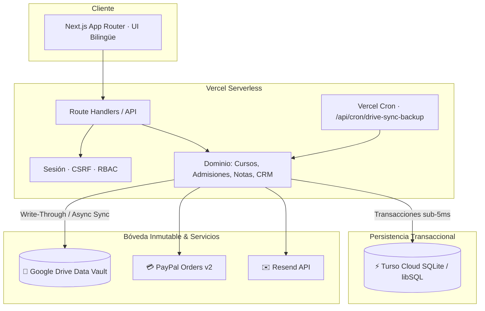
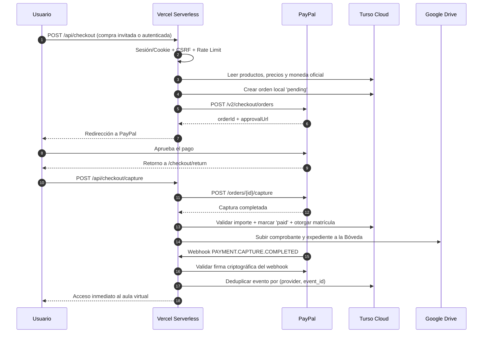

# Arquitectura · Wisdom Academy Platform

**Versión:** 2.0.0 (Cloud-Native Serverless)  
**Última actualización:** 25 de octubre de 2026  
**Entorno de Producción:** Vercel (Edge & API) + Turso (libSQL Cloud) + Google Drive (Data Vault)

---

## 1. Principios Arquitectónicos

1. **El servidor es la única autoridad:** Precios, permisos, estados de pago, derechos de acceso y actas de calificaciones se calculan y validan exclusivamente en el backend.
2. **Idempotencia por diseño:** Checkout, capturas, webhooks de PayPal, activación de matrículas y creación de carpetas en Google Drive toleran múltiples ejecuciones sin duplicación de registros.
3. **Persistencia desacoplada (Stateless Serverless):** La aplicación en Vercel es 100% libre de archivos en disco local efímero. Los datos transaccionales residen en Turso Cloud (libSQL) y los activos documentales, expedientes y respaldos residen en Google Drive.
4. **Mínima superficie de ataque:** Autenticación con cookies HttpOnly, sesiones revocables en base de datos, protección CSRF, rate limiting con sal criptográfica y RBAC estricto.
5. **Auditoría e inmutabilidad:** Cada acción administrativa, transacción financiera y acta académica genera un registro de auditoría y respaldo documental trazable.

---

## 2. Capas del Sistema



| Capa | Ubicación en Código | Responsabilidad |
|---|---|---|
| **Presentación** | `src/app`, `src/components`, `src/styles` | Páginas públicas, catálogo, aula virtual, portal del alumno/representante y accesibilidad |
| **API Serverless** | `src/app/api` | Validación Zod, autenticación, autorización RBAC y Route Handlers Serverless |
| **Dominio** | `src/server/domain` | Reglas de negocio académicas, admisiones, cursos N2N, notas y CRM |
| **Pagos** | `src/server/payments` | Integración PayPal Orders v2, webhooks firmados, deduplicación y reembolsos |
| **Persistencia** | `src/server/db` | Conector `@libsql/client`, Worker síncrono para compatibilidad, 9 migraciones y siembra |
| **Bóveda Drive** | `src/lib/drive/wisdomDriveVault.ts` | Organización automática de carpetas, subida de actas, certificados y respaldos |
| **Integraciones** | `src/lib`, `src/services` | Sincronizador escolar MINEDUC, YouTube oEmbed seguro, OpenMAIC y Moodle |

---

## 3. Estrategia de Persistencia y Dualidad Turso / SQLite

La persistencia soporta dos modos transparentes:

1. **Modo Producción Serverless (Vercel):**
   - Se conecta mediante `TURSO_DATABASE_URL` y `TURSO_AUTH_TOKEN` usando `@libsql/client`.
   - Permite consultas asíncronas de alto rendimiento y provee un puente transparente con `Worker` thread y `SharedArrayBuffer` para soportar llamadas síncronas existentes de repositorios (`prepare().get/all/run`) sin reescritura masiva.
2. **Modo Local / CI (Desarrollo y Pruebas Offline):**
   - Utiliza SQLite local (`.data/wisdom.db`) mediante `node:sqlite` para que la suite de pruebas automatizadas (`npm test`) se ejecute a máxima velocidad en cualquier máquina sin requerir conexión a internet.

---

## 4. Arquitectura de la Bóveda en Google Drive (Data Vault)

Google Drive actúa como el almacén inmutable maestro bajo una sola cuenta y carpeta raíz (`GOOGLE_DRIVE_ROOT_FOLDER_ID`):

```text
📁 Wisdom_Academy_Curriculo_Global (GOOGLE_DRIVE_ROOT_FOLDER_ID)
├── 📁 Cursos/ (189 carpetas de N2N: 10 semestres, exámenes, lecturas)
├── 📁 Talleres/ (Educación continua y talleres extracurriculares)
├── 📁 01_Primero_EGB/ ... 14_Talleres_y_Cursos_Libres/ (14 grados MINEDUC K-12)
└── 📁 Bóveda Documental y Académica:
    ├── 01_Matriculas_y_Admisiones/ (Fichas JSON/PDF y contratos)
    ├── 02_Expedientes_Estudiantes/ (Historial por alumno)
    ├── 03_Calificaciones_y_Actas/ (Actas de notas consolidadas)
    ├── 04_Certificados_y_Diplomas/ (Certificados generados descargables)
    ├── 05_Estadisticas_y_Reportes/ (Snapshots periódicos de métricas)
    └── 06_Database_Backups/ (Copias de seguridad comprimidas de Turso)
```

- **Patrón Write-Through:** Las operaciones críticas se guardan instantáneamente en Turso Cloud para latencia mínima y se replican asíncronamente en Google Drive guardando el `drive_file_id` en la base de datos.
- **Tolerancia a Fallos:** Reintentos exponenciales con jitter contra límites de cuota de la API de Google.

---

## 5. Flujo de Pago y Matrícula



---

## 6. Modelo de Datos Principal (9 Migraciones Versionadas)

| Tabla | Responsabilidad |
|---|---|
| `schema_migrations` | Registro inmutable de migraciones aplicadas (v1 a v9). |
| `users`, `sessions`, `roles`, `permissions`, `user_roles` | Identidad, sesiones seguras y control RBAC. |
| `resources`, `products`, `product_resources` | Catálogo, recursos educativos y fijación de precios. |
| `orders`, `order_items`, `checkout_registrations` | Órdenes locales, snapshot de compra y registro posterior. |
| `transactions` | Capturas, reembolsos, reversiones y transacciones gratuitas. |
| `webhook_events` | Trazabilidad y deduplicación de webhooks externos. |
| `entitlements`, `enrollments` | Derechos de acceso y matrículas a cursos/talleres. |
| `course_programs`, `course_modules`, `course_lessons` | Estructura curricular de 10 semestres de N2N. |
| `drive_folders` | Mapeo relacional de carpetas creadas en Google Drive. |
| `audit_log` | Bitácora de seguridad y auditoría administrativa. |

---

## 7. Estrategia de Calidad y Pruebas

| Suite | Comando | Cantidad | Cobertura |
|---|---|:---:|---|
| **Recursos Educativos** | `npm run test:resources` | 54 tests | Validación de video, inserción segura, curaduría y caché |
| **Plataforma Core** | `npm run test:platform` | 83 tests | 200 días escolares, RBAC, checkout, sesiones y órdenes |
| **Cursos y Talleres** | `npm run test:courses` | 49 tests | 10 semestres N2N, evaluaciones, actas y enlaces Drive |
| **Total Automatizado** | `npm test` | **186 tests** | **100% Pass · 0 Fallos** |
| **Tipado Estricto** | `npm run typecheck` | Global | TypeScript 5.7 sin `any` inseguros |
| **Seguridad** | `npm run check:secrets` | Build | Prevención de fuga de credenciales |
| **Despliegue** | `npm run check:deploy` | Cloud | Diagnóstico integral previo al lanzamiento |

---

## 8. Despliegue en Producción

- **Hosting:** Vercel Pro / Hobby optimizado con `vercel.json` en región `iad1` (Washington D.C., misma región de Turso para latencia sub-5ms).
- **Cron Jobs:** `/api/cron/drive-sync-backup` diario a las 00:00 UTC con `CRON_SECRET`.
- **Comando de Migración Inicial:** `npm run db:migrate-and-seed` desde cualquier terminal aprovisiona completamente la base de datos y la bóveda documental.
