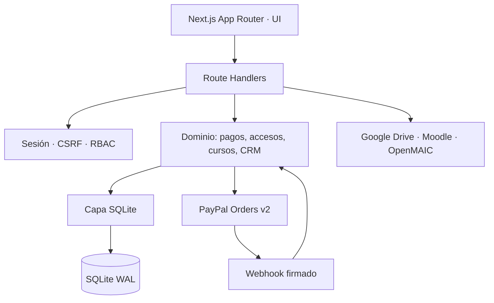
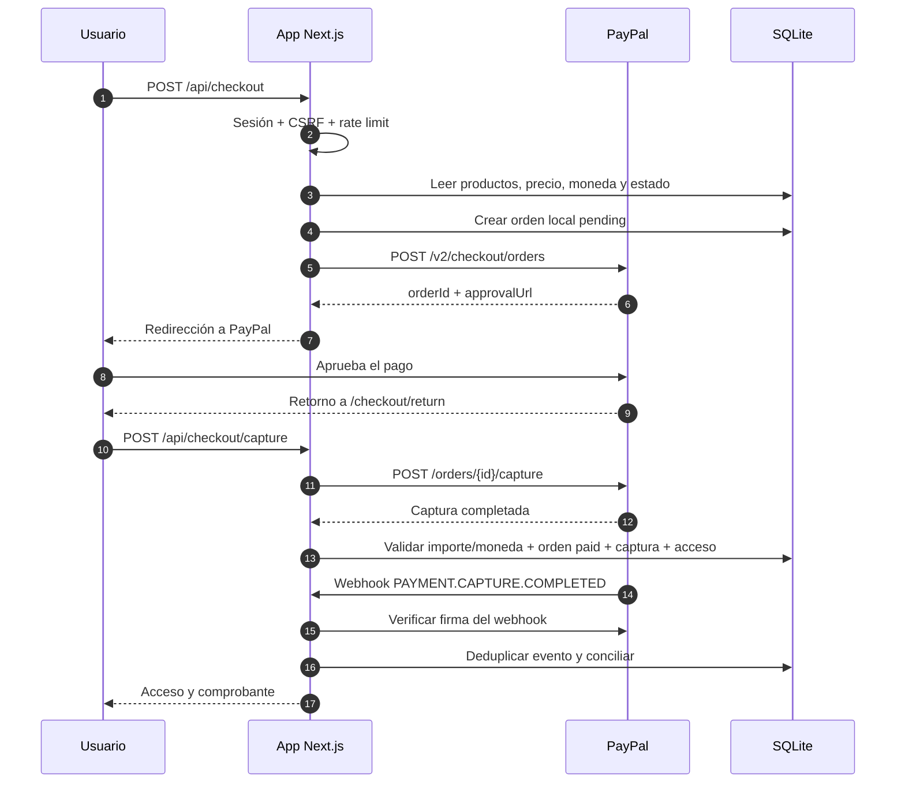

# Arquitectura · Wisdom Academy

**Versión:** 1.0.0  
**Última actualización:** 23 de octubre de 2026

## 1. Principios

1. **El servidor es la autoridad.** Precios, permisos, estados de pago, accesos y matrículas se validan en el backend.
2. **Idempotencia por defecto.** Checkout, captura, webhooks, reembolsos y activación de accesos toleran reintentos.
3. **Persistencia explícita.** SQLite con WAL, migraciones versionadas y backups; nunca un disco efímero para datos reales.
4. **Superficie mínima.** Las mutaciones requieren sesión, CSRF, permisos y límites de frecuencia.
5. **Documentación verificable.** Cada decisión de pago tiene pruebas, evidencia y un procedimiento de reversa.

## 2. Capas



| Capa | Ubicación | Responsabilidad |
|---|---|---|
| Presentación | `src/app`, `src/components`, `src/styles` | Rutas, UI, estados de carga/error y accesibilidad |
| API | `src/app/api` | Validación de entrada, autenticación, CSRF y respuestas HTTP |
| Dominio | `src/server/domain` | Reglas de negocio y transacciones |
| Pagos | `src/server/payments` | OAuth, Orders v2, webhooks y reembolsos |
| Persistencia | `src/server/db` | Esquema, migraciones, semilla, WAL y backups |
| Integraciones | `src/lib`, `src/services` | Drive, Moodle, YouTube, PDF, IA y currículo |

## 3. Flujo de pago



### Reglas de integridad

- El navegador no puede enviar el precio ni el importe.
- La moneda del producto debe coincidir con `PAYPAL_CURRENCY`.
- Un producto `price_status='pending'` no es comprable.
- Un producto debe estar publicado y todos sus recursos publicados.
- La captura debe coincidir en orden, importe y moneda.
- La activación de acceso ocurre en la misma transacción que marca la orden como pagada.
- Un reintento de captura devuelve `alreadyPaid` sin duplicar transacciones.
- Un webhook duplicado se reconoce por `(provider, event_id)`.
- Un reembolso parcial no revoca todo el acceso hasta cubrir el total.
- Un reembolso `PENDING` espera confirmación del webhook antes de revocar.

## 4. Modelo de datos principal

| Tabla | Responsabilidad |
|---|---|
| `users`, `sessions`, `roles`, `permissions` | Identidad, sesiones y RBAC |
| `resources`, `products`, `product_resources` | Catálogo y precios |
| `orders`, `order_items` | Orden local y snapshot de compra |
| `transactions` | Capturas, reembolsos, reversiones y transacciones gratuitas |
| `webhook_events` | Eventos verificados y deduplicación |
| `entitlements`, `enrollments` | Accesos y matrículas idempotentes |
| `discounts`, `discount_codes`, `discount_redemptions` | Promociones y reservas |
| `audit_log` | Trazabilidad administrativa |

La migración 8 añadió `products.price_status` con valores `defined` y `pending`. Los productos creados automáticamente desde un curso nacen pendientes; administración los habilita al fijar un precio.

## 5. Seguridad

- Cookies de sesión `HttpOnly`, `Secure` en producción y `SameSite=Lax`.
- Token CSRF para mutaciones.
- RBAC en rutas administrativas; verificación de propiedad en órdenes.
- Límite de frecuencia en checkout, captura, login y webhook.
- Webhook público sin sesión, autenticado por firma de PayPal.
- Secretos solo en variables del servidor; `PAYPAL_CLIENT_SECRET` nunca en el bundle cliente.
- Escaneo `npm run check:secrets` de fuente y `.next/static`.
- Auditoría sin almacenar tokens OAuth, tarjetas ni secretos.

## 6. Persistencia y despliegue

La arquitectura activa es **Next.js full-stack + SQLite en volumen persistente**.

- `WISDOM_DB_PATH` debe apuntar a un volumen duradero.
- Vercel Functions no ofrecen disco persistente; Vercel Production no es compatible con esta base.
- Para Vercel se requiere una migración a Turso/Neon/Supabase y una capa asíncrona.
- El `Dockerfile` prepara una imagen con Node 24 y volumen `/data`.
- `GET /api/health` verifica proceso y base de datos.

## 7. Estrategia de pruebas

| Nivel | Herramienta | Cobertura |
|---|---|---|
| Tipos | `tsc --noEmit` | Todo el proyecto |
| Unitarias/integración | Node Test Runner | Dominio, auth, accesos, cursos, pagos |
| PayPal | Servidor HTTP simulado | OAuth, órdenes, captura, webhooks, reembolsos |
| E2E | Playwright | Catálogo y flujos de interfaz |
| Secretos | Script propio | Fuente y artefactos compilados |

Comandos:

```bash
npm run typecheck
npm test
npm run test:payments
npm run test:e2e
npm run check:secrets
```

## 8. Decisiones y límites conocidos

- **Orders v2 con redirección oficial:** se evita cargar el SDK JavaScript de PayPal para no añadir scripts de terceros ni exponer configuración innecesaria. La URL de aprobación es oficial y la captura se valida en el servidor.
- **SQLite:** elegido por simplicidad operativa y bajo coste; requiere volumen persistente y backups.
- **Sin Turso todavía:** la capa actual es síncrona con `node:sqlite`; migrarla exige un refactor asíncrono.
- **Live pendiente:** no se activan cobros reales sin cuenta verificada, credenciales Live y autorización del propietario.
