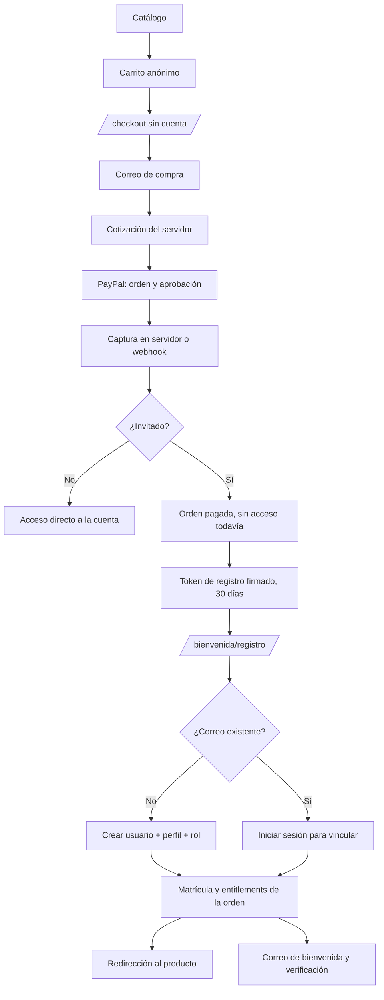

# Compra invitada, registro posterior y matrícula automática

Fecha: 2026-10-24.
Ámbito: compra sin cuenta, captura PayPal, registro posterior, creación o
vinculación de cuenta, matrícula, verificación de correo y recuperación de
contraseña. El CRM existente incorpora la bandeja **Registros**.

## 1. Diagnóstico de partida

Antes de este cambio, `/checkout` exigía una sesión antes de crear la orden.
El comprador que llegaba desde el catálogo era enviado a login y perdía la
intención de compra. La base permitía órdenes solo con `user_id` real, no
existía una pantalla de registro posterior al pago, ni expediente de comprador
invitado, ni recuperación de contraseña.

Se conservaron las fortalezas existentes:

- Precio y descuentos calculados en el servidor.
- Órdenes PayPal, captura backend, webhooks firmados e idempotencia.
- Entitlements y matrículas ya existentes.
- CRM, roles y permisos existentes.
- Componentes visuales y tokens de Wisdom Academy.

## 2. Flujo implementado



### Compra

- El checkout pide **solo el correo de compra** (y nombre opcional) antes de
  pagar.
- Si hay una sesión activa, el correo se fija al de la cuenta; no se permite
  comprar con otro correo desde esa sesión.
- El invitado usa un usuario interno `usr_guest_checkout` sin credenciales para
  mantener las claves foráneas existentes. Este usuario nunca inicia sesión y
  no aparece en el CRM.
- La orden guarda `buyer_email`, `checkout_mode`, `registration_status` y,
  tras el registro, `registered_user_id`.
- La clave de idempotencia de invitado se hashea junto al correo para impedir
  que otra persona recupere una orden reutilizando la cabecera.
- El acceso PayPal se captura con el `token` que PayPal entrega al comprador.
  Sin sesión, el `orderId` interno por sí solo no autoriza la captura.

### Registro posterior

- El token de registro es firmado con HMAC-SHA256 y contiene el id del registro
  y su caducidad. No se almacena el token en texto plano.
- La pantalla muestra pago, productos e importe; no concede acceso.
- El formulario adulto pide nombres, apellidos, país, teléfono, documento
  opcional, contraseña y consentimientos.
- Para programas de menores pide estudiante, fecha de nacimiento, grado,
  representante legal, relación y autorización específica. El menor no crea una
  cuenta independiente: la cuenta pertenece al representante.
- Los consentimientos de términos y datos son obligatorios y no vienen
  premarcados. La comunicación comercial es un checkbox separado y opcional.
- Si el correo ya existe, no se crea otra cuenta: se pide iniciar sesión y,
  con la sesión activa del mismo correo, se vincula la compra.
- La operación de usuario + orden + ficha + matrícula es transaccional. Un
  reintento no duplica cuenta, orden, entitlement ni matrícula.
- La contraseña se hashea con scrypt; nunca se envía por correo ni se guarda
  en el CRM o en logs.

### Acceso

- Los `entitlements` y `enrollments` se crean solo para los recursos de la
  orden pagada.
- La sesión se crea al terminar el registro. La respuesta establece cookie
  HttpOnly y token CSRF.
- La redirección va al primer recurso comprado (`/aula?recurso=...`) o a
  `/mi-acceso`.
- `orders.user_id` pasa del usuario invitado al usuario real dentro de la misma
  transacción; también se actualiza la redención de descuento.

## 3. Base de datos (migración 9)

Archivo: `src/server/db/sqlite.ts`.

Órdenes:

- `buyer_email`, `buyer_name`.
- `checkout_mode` (`account`/`guest`).
- `registration_status` (`not_required`/`pending`/`completed`/`expired`).
- `registered_user_id`, `registration_completed_at`.
- Backfill del correo y nombre para órdenes históricas.
- Usuario interno `usr_guest_checkout`, estado `suspended`, sin contraseña.

Nuevas tablas:

- `checkout_registrations`: comprador, tipo, producto, requisitos de
  representante, estudiante, representante, estados, consentimiento, versiones
  legales, caducidad y vínculo al usuario completado.
- `auth_tokens`: verificación de correo y recuperación de contraseña, tokens
  hasheados, caducidad y uso único.

Ampliaciones:

- `discount_redemptions.buyer_email` para límites por persona en compras
  invitadas.
- `student_profiles`: nombres, apellidos, nacimiento, país, teléfono,
  documento, datos del representante y origen.

La migración es aditiva y no elimina datos. Antes de desplegar en producción se
debe respaldar la base SQLite.

## 4. Endpoints

| Endpoint | Método | Acceso | Función |
|---|---|---|---|
| `/api/checkout` | POST | Público/sesión | Crea orden de invitado o cuenta |
| `/api/checkout/quote` | POST | Público/sesión | Cotiza sin crear orden |
| `/api/checkout/capture` | POST | Público con token PayPal / sesión | Confirma captura |
| `/api/checkout/registration` | GET | Token firmado | Vista segura del registro |
| `/api/checkout/registration` | POST | Token / sesión+CSRF | Crea o vincula cuenta y matrícula |
| `/api/checkout/registration/resend` | POST | Token | Reenvía enlace de registro |
| `/api/checkout/registration/recover` | POST | Público, respuesta genérica | Busca registros pendientes por correo |
| `/api/auth/password/forgot` | POST | Público, respuesta genérica | Envía enlace de recuperación |
| `/api/auth/password/reset` | POST | Token | Cambia contraseña y revoca sesiones |
| `/api/auth/verify-email` | POST | Token | Verifica correo |
| `/api/admin/registrations` | GET | `users.read` (+`minors.read` para menores) | Bandeja CRM |
| `/api/admin/finance` | GET | `orders.read` | Pagos y métricas |

Las rutas de registro/recuperación validan mismo origen; las autenticadas usan
CSRF. Los endpoints públicos tienen rate limiting.

## 5. CRM

**Registros** es una pestaña del CRM existente (no un CRM nuevo). Requiere
`users.read`; los expedientes de menores requieren además `minors.read`. La
tabla muestra:

- Comprador, correo, tipo (estudiante/representante).
- Productos, tipo de producto e importe.
- Estado del pago.
- Estado del registro (pendiente/completado/vencido/revocado).
- Correo verificado/pendiente.
- Matrícula activa o sin acceso.
- Fecha y referencia de orden.

La ficha muestra datos de estudiante y representante solo con permiso, y el
documento enmascarado. No se muestran tokens, contraseñas ni datos de tarjeta.

El detalle de pagos (`Pagos`) también indica si la compra fue de invitado y si
el registro posterior está pendiente o completado.

## 6. Correo

Proveedor: Resend por API HTTP (`src/server/email/mailer.ts`).

Variables:

- `RESEND_API_KEY` (solo servidor).
- `EMAIL_FROM` (remitente verificado).
- `EMAIL_REPLY_TO` (opcional).
- `APP_URL` (URLs de los enlaces).

Si el correo no está configurado:

- El registro y la matrícula funcionan.
- La UI indica que no se pudo enviar el mensaje de bienvenida.
- La recuperación de contraseña y el reenvío de enlace no pueden entregar el
  mensaje; el propietario debe configurar el proveedor.
- Los enlaces de verificación existen, pero nadie los recibe; la cuenta queda
  con correo pendiente y el CRM lo muestra así.

No se deben usar remitentes no verificados ni guardar la API key en el
repositorio.

## 7. Seguridad

- Precios, descuentos y moneda solo desde servidor.
- Token de captura de invitado ligado a la orden PayPal.
- Token de registro firmado, caducidad 30 días, sin PII en la URL.
- Token de recuperación de 60 minutos, un solo uso, almacenado por hash.
- Password con scrypt y política mínima.
- Revocación de sesiones al restablecer contraseña.
- CSRF en mutaciones autenticadas y mismo origen en flujos públicos.
- Idempotencia de checkout, captura, webhook, matrícula y descuentos.
- Los menores no tienen cuenta propia ni correo obligatorio.
- `minors.read` separa el acceso a expedientes de menores.
- Audit trail sin contraseñas ni tokens.
- La orden no concede acceso por retorno del navegador; requiere captura o
  webhook verificado y, en invitados, registro posterior.

## 8. Pruebas

```bash
npm run test:platform
npx playwright test tests/e2e/checkout-navigation.spec.ts
npx playwright test tests/e2e/rbac-navigation.spec.ts
npm run lint
npm run build
```

Cobertura nueva:

- Invitado paga y no recibe acceso antes de registrarse.
- Captura de invitado con token PayPal; token ajeno rechazado.
- Registro adulto crea usuario, perfil, rol, CRM, entitlements y orden.
- Programa de menores exige autorización y crea expediente del estudiante.
- Correo existente exige login y vincula sin duplicar.
- Reintento de registro no duplica.
- Orden pendiente y token manipulado se rechazan.
- CRM filtra y oculta menores sin `minors.read`.
- Verificación de correo de un solo uso.
- Restablecimiento de contraseña y rechazo de tokens usados/débiles.
- Flujo E2E: carrito, checkout invitado y registro posterior con sesión.

## 9. Despliegue

### Hosting actual (Northflank)

1. Respaldar el volumen SQLite (`.data/wisdom.db`).
2. Desplegar el commit; las migraciones se ejecutan al iniciar y aplican la
   versión 9.
3. Verificar `/api/health` y que `/api/auth/config` siga mostrando
   `paypalConfigured: true` solo en el entorno correcto.
4. Configurar `RESEND_API_KEY`, `EMAIL_FROM`, `EMAIL_REPLY_TO` y `APP_URL`.
5. Registrar/actualizar el webhook de PayPal con la URL pública.
6. Probar un producto gratuito o con descuento total (no requiere cargo) para
   recorrer compra, registro, CRM y acceso.
7. Probar PayPal Sandbox con comprador de prueba y un producto de pago.
8. Revisar que el webhook no duplique matrículas.

### Vercel

El proyecto **no es desplegable en Vercel Functions con SQLite** porque el
sistema de archivos es efímero. `npm run check:deploy` lo bloquea. Para Vercel
se necesita:

1. Migrar el adaptador de datos a una base administrada (Postgres/Neon,
   Turso/libSQL u otra) con migraciones equivalentes.
2. Configurar `WISDOM_DB_PATH`/conexión de la base, `APP_URL`, PayPal, correo y
   rate limit en el proyecto de Vercel.
3. Verificar que las rutas API y webhooks funcionen en Node runtime.
4. Ejecutar Sandbox y una prueba de persistencia tras reiniciar funciones.

No se declara Vercel listo mientras la persistencia siga siendo SQLite local.
El despliegue actual verificado es Northflank con volumen persistente.

## 10. Decisiones y limitaciones

- No hay auto-registro público fuera de una compra; el acceso se crea desde el
  checkout o una invitación existente.
- Una compra con varios productos que mezcle menores y adultos usa el
  expediente de representante; no se modelan hermanos múltiples en una sola
  orden.
- El documento y el teléfono adulto son opcionales; en programas de menores el
  teléfono del representante es obligatorio.
- La verificación de correo se registra y notifica, pero no bloquea el acceso
  para no romper compras si el proveedor de correo no está configurado.
- La dirección y datos de facturación no se solicitan porque no hay facturación
  electrónica implementada.
- Los textos de términos y privacidad son una base operativa versionada; deben
  ser revisados por el responsable legal antes de producción.
- La conversión promocional no se calcula: no hay eventos de visitas.
- Los reembolsos siguen el flujo existente y revocan solo los derechos de la
  compra.
