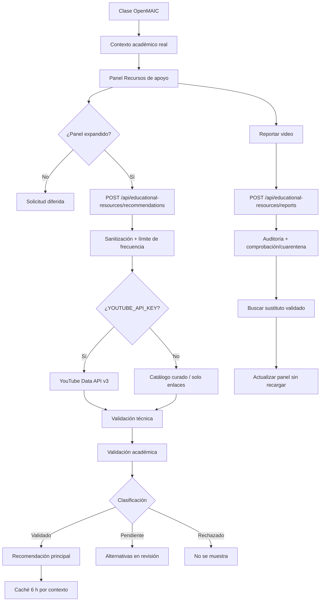

# Recursos educativos audiovisuales en OpenMAIC — Wisdom Academy

**Fecha de implementación:** 21 de octubre de 2026  
**Versión de criterios de validación:** `WA-RECURSOS-2026.10.2`  
**Versión del motor semántico:** `WA-SEMANTICA-2026.10.1`  
**Alcance:** aula OpenMAIC de estudiantes, panel lateral de recursos, API de recomendaciones, reportes y sustituciones.

---

## 1. Resumen ejecutivo

Se implementó un sistema de recursos audiovisuales complementarios integrado con el visor de diapositivas de OpenMAIC. El sistema:

- Añade un panel lateral izquierdo retráctil (`Recursos de apoyo`) que no tapa el visor en escritorio y funciona como cajón superpuesto en tablet y móvil.
- Construye la búsqueda con el contexto curricular real de la clase: asignatura, unidad, tema, subtema, objetivos, conceptos, edad, nivel, curso e idioma.
- Consulta la YouTube Data API v3 cuando existe `YOUTUBE_API_KEY`; si no existe, ofrece una búsqueda contextualizada oficial de YouTube y un catálogo curado opcional.
- Valida cada candidato en dos fases: técnica y académica. Sólo los recursos que superan ambos controles se presentan como **Validado**. Los demás se muestran como **Pendiente de revisión** o se rechazan internamente.
- **Siempre muestra el mejor video disponible.** Si no hay un validado, el primer pendiente ocupa la tarjeta principal como **Video de apoyo**, con etiqueta ámbar y explicación; ya no queda oculto tras un estado vacío.
- **Incluye un mecanismo real de validación docente:** cola de revisión por clase, panel `/admin/recursos`, seis confirmaciones obligatorias, evidencia, revisor y publicación en el catálogo curado. El recurso aprobado se mezcla con la API y se presenta como validado.
- Reproduce videos con el reproductor oficial de YouTube (dominio `youtube-nocookie.com`) y ofrece el enlace original cuando la inserción no está permitida.
- Permite reportar un video, registra la incidencia sin datos personales, aplica cuarentena o comprobación y busca una sustitución validada sin recargar la clase.
- Usa caché con vencimiento por contexto académico, límites de frecuencia, auditoría y persistencia local opcional.
- Se adapta a escritorio, tablet y móvil, con navegación por teclado y restauración de foco.
- Es escalable por perfil curricular: la auditoría actual cubre **248 clases/unidades** de Avril y Gael; los perfiles futuros se incorporan agregando su malla a `PERFILES_CURRICULARES`.

> **Estado de credenciales:** `YOUTUBE_API_KEY` está configurada y fue verificada contra YouTube (`videos.list` respondió correctamente). Las pruebas E2E interceptan la API para no depender de la red. Una búsqueda real del tema “Números enteros y recta numérica” devolvió `origen: youtube_api`, **0 validados y 2 pendientes**; el mejor pendiente (69/100) se muestra como tarjeta de apoyo y la cola de revisión real quedó registrada. No se aprobó automáticamente ningún video: la aprobación requiere una persona. Sin clave ni catálogo, el panel no inventa videos: muestra la búsqueda contextualizada.

---

## 2. Auditoría previa y decisiones de integración

### 2.1. Componentes identificados

| Componente | Archivo | Rol |
|---|---|---|
| Visor OpenMAIC | `src/components/openmaic/OpenMAICClassroomViewer.tsx` | Diapositivas, fases, controles, zoom y narración. |
| Layout del aula | `src/components/lms/PlatziCoursePlayerLayout.tsx` | Header, estado de materia/diapositiva, paneles y modales. |
| Panel derecho | `src/components/lms/PlatziClassroomRightPanel.tsx` | Ruta académica Moodle, chat IA, Moodle y apuntes. |
| Motor curricular | `src/services/curriculumContentEngine.ts` | Genera lecciones, diapositivas, intervenciones y contexto. |
| Datos curriculares | `src/data/curriculum/*` | Perfiles de Gael (4.° EGB) y Avril (8.° EGB), asignaturas y unidades. |
| Diseño | `src/styles/tokens.css`, `responsive.css` | Tokens de color, tipografía, breakpoints 1100/900/700/420. |
| Configuración | `.env.example`, `src/lib/auth/authContext.tsx` | Variables de entorno y sesión local. |

### 2.2. Hallazgos relevantes

1. **El visor usa cuatro fases por unidad.** El layout reutilizaba `diapositivaActual` como si fuera a la vez la fase y la lección de la ruta Moodle. Al elegir una lección con id > 4, el visor caía en la primera diapositiva. Se separó `unidadActivaId` (unidad curricular) de `diapositivaActual` (fase 1–4), sin reescribir el visor.
2. **El panel derecho mostraba lecciones como `div` con `onClick`.** Se añadieron `role="button"`, `tabIndex`, manejo de Enter/Espacio y `aria-pressed` para que la ruta académica sea operable por teclado.
3. **El modal compartido no gestionaba foco.** Se añadió foco inicial, trampa de Tab y restauración de foco en `src/components/ui/Modal.tsx`.
4. **El dock móvil tenía cuatro columnas.** Se añadió la acción “Recursos” y se actualizó a cinco columnas.
5. **No existía infraestructura de pruebas.** Se añadió el runner nativo de Node con `tsx` para pruebas unitarias/de servicio y Playwright con el Edge instalado para pruebas reales de navegador.
6. **No había integración de YouTube.** No se reutilizó ningún servicio inexistente ni se añadieron dependencias de backend; la integración es una ruta API de Next.js con cliente HTTP nativo.

### 2.3. Estrategia de integración segura

- El panel se inserta como hermano flex antes de `<main>`, dentro de `.wa-classroom-content`. No se modifica la estructura interna del visor.
- En escritorio ocupa 56 px contraído y 312 px expandido; el visor conserva `flex: 1` y su `ResizeObserver` recalcula el lienzo.
- En tablet/móvil se convierte en un cajón `position: fixed` con fondo oscurecido, para no comprimir la lectura.
- El estado del panel se guarda en `sessionStorage` y se restaura durante la sesión.
- Toda la búsqueda/validación ocurre en el servidor y de forma asíncrona; un fallo de YouTube nunca bloquea la clase.

---

## 3. Arquitectura final



### 3.1. Capas

| Capa | Archivos | Responsabilidad |
|---|---|---|
| Dominio | `src/types/educationalResources.ts` | Contratos de contexto, recursos, validación, reportes y respuestas. |
| Utilidades puras | `src/lib/educational-resources/text.ts` | Consulta contextual, IDs, URLs, duración, normalización, clave de caché. |
| Validación | `academicValidator.ts`, `technicalValidator.ts` | Evidencia académica y técnica, clasificación. |
| Proveedor | `youtubeProvider.ts`, `catalog.ts` | YouTube API, oEmbed y catálogo curado. |
| Infraestructura | `cache.ts`, `rateLimit.ts`, `store.ts` | TTL, ventanas de frecuencia, persistencia de reportes/auditoría/cuarentena. |
| Orquestación | `service.ts` | Ranking, caché, reportes, sustituciones, validación de enlaces. |
| Rutas API | `src/app/api/educational-resources/*` | Entradas HTTP, sanitización, límites, respuestas seguras. |
| UI | `EducationalResourcesPanel.tsx`, `EducationalVideoPlayer.tsx` | Panel, tarjeta, alternativas, reproductor, reporte y validación de enlace. |

### 3.2. Construcción del contexto

`curriculumContentEngine.obtenerContextoAprendizaje()` devuelve:

- Edad, nivel, curso/grado.
- Asignatura y área.
- Unidad, tema y subtema (concepto clave).
- Objetivos y conceptos de la asignatura.
- Idioma de la clase (`es` o `en`).
- Número de fase, etiqueta de fase y contenido textual de la diapositiva.

No incluye nombre, correo ni identificador del estudiante. La selección de videos depende del currículo, no de datos personales.

La clave de caché incluye asignatura, unidad, tema, subtema, curso, nivel, banda de edad e idioma. **No incluye el número de diapositiva**, para no ejecutar búsquedas en cada avance. Al cambiar de unidad, asignatura o tema, la clave cambia y el panel actualiza las recomendaciones.

---

## 4. Búsqueda y validación

### 4.1. Consulta contextual

Ejemplo generado:

```text
Fracciones equivalentes comparar fracciones con distinto denominador Matemáticas 4.° de EGB primaria explicación paso a paso español
```

Para una clase de inglés, se construye una consulta en ese idioma (`explained step by step`, nivel y `English`).

La consulta ya no parte del título de la materia. El motor `src/lib/educational-resources/semanticSearch.ts` construye un perfil semántico de la lección con:

- el tema y la unidad;
- el subtema y los conceptos clave;
- el título real de la diapositiva;
- los objetivos pertinentes;
- las oraciones del material que comparten términos con el tema, descartando repasos de otras lecciones.

Con ese perfil genera hasta tres consultas: lección específica, palabras clave y unidad de respaldo. El proveedor usa primero la consulta de lección y, si devuelve pocos resultados, una segunda consulta semántica. La asignatura queda al final para que no domine la búsqueda. El validador académico usa el mismo perfil: reconoce coincidencias en título, descripción, canal y temas curados, incluidas frases con otro orden o palabras intermedias, y rechaza los videos que solo mencionan la materia o el nivel.

La búsqueda oficial usa:

- `type=video`
- `order=relevance`
- `relevanceLanguage=es|en`
- `regionCode=EC` (configurable)
- `safeSearch=strict`
- `videoEmbeddable=true`
- `videoSyndicated=true`
- `maxResults=10`

Después se consultan los detalles de cada video (`videos.list`) para obtener duración, privacidad, estado de procesamiento, inserción, restricciones regionales e idioma declarado.

### 4.2. Fase A — Validación técnica

Se comprueba y se registra:

1. Formato estricto del ID (`11` caracteres `[A-Za-z0-9_-]`).
2. Existencia mediante API u oEmbed.
3. Privacidad (`public`, `unlisted`, `private`).
4. Estado de procesamiento (`processed`).
5. Inserción permitida (`status.embeddable`).
6. Restricciones regionales (`regionRestriction`) contra la región configurada.
7. Duración e idioma verificables cuando la fuente los ofrece.

Cada comprobación tiene resultado `pasa`, `falla` o `no_verificable`. Un video no se declara funcional sólo porque la URL tenga formato correcto o porque oEmbed responda: sin evidencia de inserción/región, queda pendiente.

### 4.3. Fase B — Validación académica

Se contrastan los metadatos públicos con el contexto:

- Cobertura de los términos del tema en el título (peso alto) y en título + descripción.
- Cobertura de conceptos y objetivos.
- Señales didácticas (`explicación`, `aprende`, `paso a paso`, `ejercicios`, `primaria`, `secundaria`, `tutorial`, etc.).
- Idioma declarado, revisión manual vigente o heurística conservadora.
- Duración adecuada para la edad.
- Términos incompatibles con el entorno escolar.
- Títulos sensacionalistas (penalización).

**Evidencia utilizada:** título, descripción, canal, duración, idioma y estado técnico. No se analiza el video completo ni los subtítulos. La interfaz lo declara expresamente en “Detalles de validación”.

### 4.4. Clasificación

| Estado | Significado | Se muestra como |
|---|---|---|
| `VALIDADO` | Superó controles técnicos y hay evidencia académica suficiente, o fue aprobado por revisión docente. | Recomendación principal. |
| `PENDIENTE_REVISION` | Existe y parece pertinente, pero falta evidencia (idioma, inserción, región o revisión). | Tarjeta principal **Video de apoyo** si no hay validado; siempre con etiqueta ámbar. |
| `RECHAZADO` | Irrelevante, inseguro, inaccesible o sin correspondencia suficiente. | No se muestra. |
| `RETIRADO_TEMPORAL` | Cuarentena por reportes o contenido inapropiado. | No se recomienda. |

Cada recurso visible incluye `versionCriterios`, `fechaValidacion`, comprobaciones técnicas, puntuación académica, motivos y nivel de evidencia (`metadatos` o `revision_manual`).

### 4.5. Caché

- Clave: contexto académico + versión de criterios + versión del motor semántico + región + modo del proveedor.
- TTL: 6 horas con resultados validados; 30 minutos sin resultados.
- Respaldo `stale-if-error`: si YouTube falla, se reutiliza la última respuesta verificada (hasta 7 días) y se marca `cache: 'stale'` con advertencia.
- Persistencia opcional en `.data/educational-resources/state.json`.
- Caché de navegador por contexto, con vencimiento, para mostrar el último recurso mientras se actualiza.

---

## 5. Panel lateral, reproductor y responsive

### 5.1. Comportamiento

| Viewport | Panel | Visor |
|---|---|---|
| Escritorio (> 1279 px) | En flujo: 56 px contraído / 312 px expandido. | Recupera el ancho automáticamente. |
| Tablet (≤ 1279 px) | Cajón superpuesto de 360 px con fondo oscurecido. | Mantiene su ancho; no se comprime. |
| Móvil (≤ 700 px) | Cajón de 340 px; disparador sobre el dock inferior. | Diapositivas legibles; sin scroll horizontal. |

- Botón visible de expansión (riel en escritorio, disparador flotante o dock “Recursos”).
- Cierre con botón, clic en el fondo o `Escape`.
- Foco al abrir y retorno al disparador al cerrar.
- El **mejor recurso disponible** ocupa la tarjeta: validado si existe; si no, el primer pendiente como **Video de apoyo** con etiqueta ámbar. El estado vacío sólo aparece cuando no hay ningún candidato.
- La tarjeta pendiente incluye **Solicitar revisión** para priorizar el video en la cola docente.
- El encabezado incluye **Actualizar recomendaciones**; tras una aprobación, el estudiante puede refrescar sin recargar la clase.
- Dos pestañas internas conservan su estado: **Para esta clase** y **Buscar otros videos**. La búsqueda filtra los recursos ya cargados por título, canal, descripción y motivos; el video actual queda fijado arriba y no se reemplaza.
- Los títulos, canales, insignias y alternativas usan `overflow-wrap`, `word-break` y límite de tres líneas para evitar desbordamientos; hay una prueba E2E con un título largo sin espacios que verifica la relación 16:9 de la miniatura y la altura de tres líneas.
- Al cruzar de escritorio a tablet/móvil, el panel se contrae para no aparecer como cajón inesperado sobre la clase; puede reabrirse con el disparador.
- `prefers-reduced-motion` desactiva las transiciones.
- Áreas seguras (`safe-area-inset-*`) respetadas en el cajón y en el disparador.
- La transición de ancho del panel es una excepción deliberada a la regla de animar sólo `transform/opacity`: es necesaria para que el visor recupere espacio de forma fluida. Es de 240 ms y se desactiva con movimiento reducido.

### 5.2. Reproductor

- Al seleccionar un video se abre un visor amplio dentro del aula (modal accesible de hasta 980 px), no una pestaña externa ni un reproductor confinado a los 312 px del panel.
- `iframe` oficial con `https://www.youtube-nocookie.com/embed/{id}`, `enablejsapi=1`, `origin` del sitio, `playsinline=1`, `rel=0` y `cc_lang_pref`; sin `autoplay` y sin parámetros que alteren la marca.
- `allowFullScreen`, `referrerPolicy="strict-origin-when-cross-origin"`. Los controles nativos de YouTube permanecen intactos y no se superpone ningún elemento sobre ellos.
- La IFrame Player API se carga de forma diferida para detectar errores de inserción (100, 101, 150, etc.) y mostrar un fallback con el título conservado, **Reintentar**, **Abrir en YouTube** y **Buscar otros videos**.
- Si la inserción no está permitida desde el inicio, no se renderiza el iframe: el visor muestra el enlace oficial y las alternativas, sin bloquear la selección.
- Cierre del visor con retorno a la tarjeta, botón **Volver al aula** que contrae el panel y **Volver al video anterior** cuando existe historial de la sesión.
- La posición de reproducción se conserva de forma aproximada con el parámetro oficial `start` cuando el estudiante vuelve a un video; no se reproduce automáticamente.
- La miniatura, el botón **Reproducir** y cada alternativa inician la reproducción en el visor con un solo clic. Un video validado nunca queda inutilizable por su estado de validación.
- El propio visor incluye la lista **Otras explicaciones para este tema**. Cada sugerencia se puede seleccionar y reproducir; si está pendiente, el botón **Validar y reproducir** llama a la API de validación, incorpora el recurso y lo reproduce sin salir del aula.
- Al cambiar de video, el anterior se conserva en un historial de hasta ocho recursos durante la sesión; la vista, la consulta, el video actual y la posición de la lista se restauran al reabrir el panel.

### 5.3. Flujo de reporte

1. El estudiante elige uno de los siete tipos de incidencia.
2. Puede añadir un comentario opcional; se le indica que no incluya datos personales.
3. El servidor registra ID, clase, unidad, tema, tipo, fecha y un hash anónimo del cliente.
4. Se deduplican reportes y se aplican límites (6/10 min y 20/día por cliente).
5. Un reporte aislado degrada el recurso a **pendiente de revisión** durante 6 h; no se declara roto.
6. Dos reportantes distintos, o un reporte de contenido inapropiado, aplican cuarentena (24 h; global para fallos técnicos/contenido, por contexto para relevancia/idioma).
7. Se busca una alternativa validada entre las candidatas, excluyendo el video reportado y los ya reportados.
8. Se actualiza la tarjeta sin recargar. Si no hay alternativa validada, se muestra la búsqueda contextualizada.
9. Se registra la sustitución y su motivo en la auditoría. Máximo 3 sustituciones automáticas por contexto cada 6 h para evitar ciclos.

### 5.4. Revisión docente y publicación

El sistema incluye el mecanismo que faltaba para superar el estado pendiente:

1. Cuando una clase no tiene validados, el servicio registra el mejor pendiente en la cola de revisión (`candidatosRevision`).
2. El estudiante puede pulsar **Solicitar revisión**; esto marca el candidato como `SOLICITADA`, pero **no lo valida**.
3. Un usuario con rol `ADMIN` abre `/admin/recursos` (o **Panel Administrativo → Recursos Audiovisuales**) e introduce `EDUCATIONAL_RESOURCES_ADMIN_TOKEN`.
4. El revisor selecciona el candidato, reproduce o abre el video y confirma seis controles:
   - pertinencia curricular;
   - idioma;
   - nivel y edad;
   - seguridad del contenido;
   - reproducción integrada;
   - disponibilidad regional.
5. Registra su nombre y la evidencia de revisión. La aprobación exige las seis confirmaciones.
6. El servidor publica el recurso en `.data/educational-resources/curated.json`, marca el candidato como `APROBADA`, registra auditoría y **invalida la caché** de esa clase.
7. El proveedor mezcla siempre el catálogo curado con los resultados de YouTube. El validador académico reconoce la revisión manual vigente como evidencia principal, incluso si los metadatos no coinciden al 100%.
8. El estudiante pulsa **Actualizar recomendaciones** (o reabre el panel) y el video aprobado aparece como **Validado**.

Seguridad:

- El token se configura sólo en el servidor (`EDUCATIONAL_RESOURCES_ADMIN_TOKEN`) y se compara en tiempo constante.
- El panel lo captura en `sessionStorage`; no forma parte del bundle ni se guarda en Git.
- Sin token configurado, las rutas de revisión y aprobación responden 503; con token incorrecto, 401.
- La aprobación nunca es automática. Un clic de estudiante sólo crea una solicitud.

### 5.5. Cobertura de todas las clases y años futuros

- `npm run resources:audit` enumera **todos los perfiles, asignaturas y unidades** registrados y genera la consulta contextual y la URL de búsqueda de YouTube para cada clase. En la auditoría actual: **2 perfiles y 248 unidades**.
- `npm run resources:audit -- --live --limit=5` consulta la API real para una muestra (máximo 20 por ejecución) y actualiza la cola de revisión. Sin `--live` no consume cuota.
- El contexto del aula se obtiene con `obtenerContextoAprendizajeDesdePerfil(perfil, ...)` y el motor Moodle/lecciones acepta el perfil opcional. Al agregar un perfil futuro a `PERFILES_CURRICULARES`, el aula, la búsqueda y la auditoría lo incorporan sin cambiar el panel.
- Cada clase tiene siempre una búsqueda contextual preparada; si YouTube devuelve candidatos, se muestra el mejor (validado o pendiente etiquetado). Si no devuelve ninguno, se ofrece la búsqueda externa.

---

## 6. Archivos creados

### Backend y dominio

- `src/types/educationalResources.ts`
- `src/lib/educational-resources/constants.ts`
- `src/lib/educational-resources/text.ts`
- `src/lib/educational-resources/academicValidator.ts`
- `src/lib/educational-resources/technicalValidator.ts`
- `src/lib/educational-resources/catalog.ts`
- `src/lib/educational-resources/youtubeProvider.ts`
- `src/lib/educational-resources/cache.ts`
- `src/lib/educational-resources/rateLimit.ts`
- `src/lib/educational-resources/store.ts`
- `src/lib/educational-resources/requestValidation.ts`
- `src/lib/educational-resources/adminAuth.ts`
- `src/lib/educational-resources/service.ts`
- `src/app/api/educational-resources/recommendations/route.ts`
- `src/app/api/educational-resources/reports/route.ts`
- `src/app/api/educational-resources/validate/route.ts`
- `src/app/api/educational-resources/review/route.ts`
- `src/app/api/educational-resources/approve/route.ts`

### Interfaz y administración

- `src/components/lms/EducationalResourcesPanel.tsx`
- `src/components/lms/EducationalVideoPlayer.tsx`
- `src/components/admin/EducationalResourcesAdminPanel.tsx`
- `src/app/(admin)/admin/recursos/page.tsx`
- `src/styles/educational-resources.css`
- `docs/evidencias/recursos-escritorio.png`
- `docs/evidencias/recursos-tablet.png`
- `docs/evidencias/recursos-movil.png`

### Pruebas y auditoría

- `playwright.config.ts`
- `scripts/audit-educational-resources.ts`
- `tests/educational-resources/text.test.ts`
- `tests/educational-resources/validators.test.ts`
- `tests/educational-resources/service.test.ts`
- `tests/educational-resources/context.test.ts`
- `tests/educational-resources/review.test.ts`
- `tests/educational-resources/provider.test.ts`
- `tests/e2e/educational-resources.spec.ts`

## 7. Archivos modificados

- `src/components/lms/PlatziCoursePlayerLayout.tsx` — panel, selector de asignatura, separación unidad/fase, estado de sesión, dock de 5 acciones, integración del contexto.
- `src/components/lms/PlatziClassroomRightPanel.tsx` — lecciones accesibles por teclado (`role="button"`, `aria-pressed`) y perfil curricular opcional.
- `src/components/admin/AdminDashboard.tsx` — pestaña **Recursos Audiovisuales**.
- `src/components/ui/Modal.tsx` — foco inicial, trampa de Tab, Escape y restauración de foco.
- `src/services/curriculumContentEngine.ts` — contexto por perfil, `obtenerContextoAprendizajeDesdePerfil()`, perfil opcional en lecciones e intervenciones.
- `src/lib/lms-moodle/moodleDomain.ts` — perfil opcional y IDs de curso derivados del grado.
- `src/app/layout.tsx` — importación de `educational-resources.css`.
- `src/styles/responsive.css` — dock móvil de 5 columnas.
- `.env.example` — variables de YouTube, recursos y token administrativo.
- `.gitignore` — `.data/`, resultados de pruebas, `*.tsbuildinfo`.
- `package.json` / `package-lock.json` — scripts `typecheck`, `test:resources`, `test:e2e`, `resources:audit`; dependencia de desarrollo `@playwright/test`.

---

## 8. Configuración

### 8.1. Variables de entorno

```env
# Sólo servidor. No usar NEXT_PUBLIC_.
YOUTUBE_API_KEY=
YOUTUBE_REGION_CODE=EC

# Catálogo curado opcional en JSON.
EDUCATIONAL_VIDEO_CATALOG_PATH=

# Persistencia local de reportes, auditoría y caché.
EDUCATIONAL_RESOURCES_DATA_DIR=.data/educational-resources
EDUCATIONAL_RESOURCES_PERSIST=true

# Sal para anonimizar identificadores de red.
EDUCATIONAL_RESOURCE_RATE_LIMIT_SALT=cambia-esta-sal-en-produccion

# Token del panel de revisión docente (/admin/recursos).
# En este entorno se generó uno y quedó en .env; no se imprime en la documentación.
EDUCATIONAL_RESOURCES_ADMIN_TOKEN=
```

### 8.2. Obtener la clave de YouTube

1. Entrar a Google Cloud Console.
2. Crear un proyecto y habilitar **YouTube Data API v3**.
3. Crear una clave de API.
4. Restringirla a YouTube Data API v3 y a las IP del servidor.
5. Colocarla en `.env` como `YOUTUBE_API_KEY` y reiniciar el servidor.

**Cuota:** una búsqueda cuesta ~100 unidades y los detalles ~1. La búsqueda semántica usa como máximo dos consultas por recomendación (200 unidades), y solo ejecuta la segunda si la primera devuelve menos de seis resultados. La cuota gratuita típica (10.000 unidades/día) permite decenas de búsquedas nuevas; la caché de 6 h reduce el consumo.

### 8.3. Catálogo curado y panel de revisión

Ruta: `.data/educational-resources/curated.json` o `EDUCATIONAL_VIDEO_CATALOG_PATH`.

El catálogo se consulta **siempre** y se mezcla con los resultados de YouTube cuando hay API. Un recurso aprobado por el panel docente se escribe aquí y puede convertirse en la recomendación validada de esa clase.

Plantilla (los IDs y datos deben ser reales y verificados; la semilla está vacía a propósito):

```json
[
  {
    "id": "ID_DE_11_CARACTERES_VERIFICADO",
    "titulo": "Título exacto verificado",
    "canal": "Canal de YouTube",
    "descripcion": "Descripción breve verificada",
    "duracionSegundos": 720,
    "idioma": "es",
    "temas": ["fracciones equivalentes"],
    "asignaturas": ["Matemáticas"],
    "niveles": ["Básica Elemental"],
    "embedVerificado": true,
    "regionPermitida": true,
    "privacidadVerificada": "public",
    "revisionManual": {
      "validador": "Responsable académico",
      "fecha": "2026-10-21",
      "versionCriterios": "WA-RECURSOS-2026.10.2",
      "evidencia": "Registro de revisión, fecha y observaciones",
      "alcance": "ambos"
    }
  }
]
```

Reglas del catálogo:

- `embedVerificado`, `privacidadVerificada` y `regionPermitida` deben provenir de una comprobación real.
- `revisionManual.versionCriterios` debe coincidir con la versión vigente; revisiones antiguas no se usan como evidencia actual.
- Si falta evidencia, el recurso se muestra como pendiente, nunca como validado.
- El archivo se lee en el servidor; no se expone al cliente.

### 8.4. Cómo usar el panel de revisión docente

1. Abre `C:\wisdom academy\.env` y localiza `EDUCATIONAL_RESOURCES_ADMIN_TOKEN`. En este entorno ya se generó un token; no se imprime por seguridad.
2. Reinicia el servidor para que cargue el token.
3. Inicia sesión con una cuenta de rol `ADMIN` (la cuenta maestra existente).
4. Entra a `/admin/recursos` o a **Panel Administrativo → Recursos Audiovisuales**.
5. Pega el token cuando el panel lo solicite. Se guarda sólo en `sessionStorage`.
6. Selecciona un candidato de la cola, revisa el video (iframe o enlace externo), marca las seis confirmaciones y registra tu nombre y la evidencia.
7. Pulsa **Aprobar y publicar**. El recurso se escribe en el catálogo curado y se invalida la caché de esa clase.
8. En el aula, pulsa **Actualizar recomendaciones** o reabre el panel. El video aparecerá como **Validado** con evidencia de revisión manual.
9. Si una clase aún no tiene candidato, ábrela en el aula para generarlo, o ejecuta `npm run resources:audit -- --live --limit=5` para consultar una muestra y poblar la cola.

Si el token no está configurado, las rutas responden `503`; si es incorrecto, `401`. La aprobación nunca se ejecuta desde el aula: **Solicitar revisión** sólo prioriza el candidato.

---

## 9. Pruebas ejecutadas y resultados reales

### 9.1. Comandos y resultados

| Comando | Resultado |
|---|---|
| `npm run typecheck` | **Pasa** (sin errores). |
| `npm run test:resources` | **46/46 pruebas pasan** (~3,3 s). |
| `npx playwright test` | **13/13 pruebas pasan** (~1,6 min, Edge real). |
| `npm run build` | **Pasa**. Next.js 14.2.35 compila, lint y tipos correctos; 24 rutas generadas. |
| `npm run resources:audit` | **2 perfiles, 248 clases/unidades** con consulta y URL de búsqueda. |

Las pruebas E2E se ejecutaron con Microsoft Edge instalado (`channel: 'msedge'`). Para Chrome:

```powershell
$env:PLAYWRIGHT_CHANNEL='chrome'; npx playwright test
```

Si el puerto 3000 está ocupado por una instancia anterior y se quiere probar otra instancia:

```powershell
$env:PLAYWRIGHT_BASE_URL='http://127.0.0.1:3001'; npx playwright test
```

### 9.2. Cobertura de escenarios

| Escenario | Prueba | Resultado |
|---|---|---|
| Apertura/cierre del panel | E2E `escritorio: abre, contrae...` | Pasa |
| Recuperación de espacio del visor | E2E mide el ancho de `.wa-classroom-main` antes/después | Pasa (+150 px al contraer) |
| Reproducción integrada | E2E verifica `iframe` con `/embed/TestVideo01` | Pasa |
| Video privado/eliminado | Unitarias `validators.test.ts` | Pasa |
| Restricción de inserción | Unitaria: `embedPermitido: false` → pendiente | Pasa |
| Accesible pero irrelevante | Unitaria: Minecraft → rechazado | Pasa |
| Título publicitario | Unitaria: descuento/oferta → rechazado | Pasa |
| Idioma incorrecto | Unitaria: inglés declarado en clase de español → rechazado | Pasa |
| Sin videos validados | E2E estado vacío + búsqueda contextual | Pasa |
| Mejor pendiente como tarjeta principal | E2E: 0 validados + 1 pendiente, tarjeta “Video de apoyo” visible | Pasa |
| Título largo sin desbordamiento | E2E mide `scrollWidth` de tarjeta y título | Pasa |
| Solicitud de revisión | E2E pulsa “Solicitar revisión” y verifica `SOLICITADA` | Pasa |
| Aprobación docente y publicación | E2E recorre `/admin/recursos`, seis confirmaciones y aprobación | Pasa |
| Cola real con token | Prueba real con el token de `.env`: 1 candidato registrado | Pasa |
| Cobertura de todas las clases | `npm run resources:audit`: 2 perfiles, 248 unidades | Pasa |
| Fallo de API y reintento | E2E: primera respuesta 500, luego recomendación | Pasa |
| Reporte de enlace roto | E2E selecciona “El enlace está roto” y verifica `ENLACE_ROTO` | Pasa |
| Sustitución automática | E2E + unitarias | Pasa |
| Sin alternativa validada | Unitaria: devuelve búsqueda, no sustituye | Pasa |
| Reportes abusivos | Unitaria: 7.º reporte bloqueado | Pasa |
| Ciclos de sustitución | Unitaria: bloqueo tras 3 reemplazos | Pasa |
| Cambio de unidad/asignatura | E2E verifica nuevas consultas contextuales | Pasa |
| Escritorio/tablet/móvil | E2E 1440×900, 1024×768, 834×1112, 390×844 | Pasa |
| Sin scroll horizontal | E2E mide `scrollWidth` vs `innerWidth` | Pasa |
| Teclado y foco | E2E Enter/Escape y retorno de foco; modal con trampa de Tab | Pasa |
| Progreso preservado | E2E verifica “Progreso: 0 de 12 lecciones” tras reportar | Pasa |
| Estado del panel en sesión | E2E recarga y comprueba `sessionStorage` | Pasa |
| Regresión del visor | E2E verifica `.wa-slide-title` y reproducción | Pasa |

### 9.3. Evidencias visuales

- `docs/evidencias/recursos-escritorio.png` — panel expandido, visor y panel derecho.
- `docs/evidencias/recursos-tablet.png` — cajón superpuesto en 834×1112.
- `docs/evidencias/recursos-movil.png` — cajón en 390×844.
- `docs/evidencias/recursos-pendiente.png` — tarjeta “Video de apoyo” con título largo, etiqueta pendiente y solicitud de revisión.
- `docs/evidencias/admin-revision.png` — panel docente con la aprobación publicada.

> Las capturas se generaron con Playwright interceptando la API y usando identificadores de prueba. La comprobación real con YouTube se hizo por separado (ver 9.4).

### 9.4. Verificación real con YouTube

Se ejecutaron tres comprobaciones reales:

1. **Conectividad de la clave:** `videos.list` para un video público respondió `API YouTube: OK (items=1)`.
2. **Búsqueda contextual real:** para “Números enteros y recta numérica” (8.° EGB, Matemáticas):
   - Origen: `youtube_api`.
   - Consulta resultante: `Números enteros y recta numérica explicación paso a paso 8.° de EGB secundaria español Matemáticas y Pre-Álgebra`.
   - Resultado: **0 validados, 2 pendientes**.
   - Mejor candidato: un video de 69/100 sobre representar, comparar y ordenar enteros.
   - Comportamiento actual: ese mejor candidato se muestra como **Video de apoyo** en la tarjeta principal, con etiqueta “Pendiente de revisión” y botón “Solicitar revisión”. Ya no se oculta.
3. **Cola de revisión real:** con el token administrativo de `.env`, `GET /api/educational-resources/review` devolvió **1 candidato** (`PENDIENTE`, 69/100) para esa unidad. No se aprobó automáticamente: la aprobación requiere que una persona revise el video y confirme los seis controles.

Esto confirma la clave, búsqueda, caché, tarjeta de apoyo, cola y token. Para convertir el video en **Validado**, el revisor debe aprobarlo en `/admin/recursos`; después el aula lo mostrará como validado al actualizar.

Pasos manuales restantes:

1. Abrir `/aula` con una unidad cuyo tema exista en YouTube.
2. Verificar que, si no hay validado, la tarjeta muestre el mejor pendiente como **Video de apoyo**, no un estado vacío.
3. Abrir `/admin/recursos` con rol `ADMIN`, introducir el token de `.env`, revisar el video y aprobarlo con las seis confirmaciones y la evidencia.
4. Volver al aula y pulsar **Actualizar recomendaciones**; el recurso aprobado debe aparecer como **Validado**.
5. Reproducir el video y comprobar el enlace externo.
6. Reportar el video y verificar la sustitución sin recargar.
7. Probar “Buscar otros videos” y “Validar enlace” con un video elegido.

---

## 10. Seguridad, privacidad y límites

### 10.1. Medidas implementadas

- Clave de YouTube sólo en el servidor (`runtime = 'nodejs'`); nunca en `NEXT_PUBLIC_*`.
- IDs de YouTube validados con expresión regular estricta.
- URLs construidas con `URL`/`URLSearchParams`; no se aceptan hosts externos.
- El cliente no renderiza HTML del servidor; todo es texto React.
- Contexto sanitizado y acotado; se descartan campos no permitidos.
- Reportes sin nombre, correo ni comentario almacenado; sólo un hash anónimo con sal.
- Límites de frecuencia por cliente anónimo y por video/contexto.
- Deduplicación de reportes y máximo de sustituciones.
- Auditoría de eventos sin datos personales.
- Retención máxima de 180 días para reportes, sustituciones y auditoría.
- `rel="noopener noreferrer"` en enlaces externos.
- Iframe con `youtube-nocookie.com` y `referrerPolicy` restringido.

### 10.2. Limitaciones conocidas

1. **Sin `YOUTUBE_API_KEY` no hay recomendaciones automáticas validadas.** En este entorno la clave está configurada y verificada; en un despliegue sin clave, el panel muestra búsqueda contextual y no inventa resultados. Para videos reales hay que configurar la clave o el catálogo curado.
2. **La validación académica automática es basada en metadatos.** No se analiza el video completo, los fotogramas ni los subtítulos. Para una validación curricular profunda se requiere la revisión docente del panel `/admin/recursos`; la interfaz declara el nivel de evidencia.
3. **oEmbed no prueba inserción ni región.** Sin API o sin revisión manual, el recurso queda pendiente aunque exista.
4. **La heurística de idioma es conservadora.** Si el idioma no está declarado y no hay evidencia suficiente, el video queda pendiente; es intencional para no validar falsos positivos.
5. **Persistencia local monoinstancia.** `.data/educational-resources/state.json` no se comparte entre varias instancias. En serverless de sólo lectura, el sistema sigue en memoria. Para producción multiinstancia se recomienda una base de datos o un almacén compartido y límites en el proxy.
6. **Límites en memoria por proceso.** No sustituyen un rate limit distribuido.
7. **Búsqueda externa sólo como alternativa.** La vista interna **Buscar otros videos** filtra los recursos ya cargados y conserva el video actual; además permite validar un enlace pegado. Si el estudiante necesita descubrir material fuera de la lista, el enlace a la búsqueda de YouTube se abre en otra pestaña de forma explícita y sus resultados no se consideran validados. Para hacer permanente un enlace, se aprueba desde `/admin/recursos`.
8. **La aprobación docente es humana y requiere token.** Un clic de estudiante sólo crea una solicitud (`SOLICITADA`); no valida el video. El token administrativo es sensible: en producción debe viajar por HTTPS y rotarse si se filtra.
9. **La aprobación puede quedar obsoleta.** Si el video se elimina o cambia, los reportes, la comprobación y la cuarentena lo retiran temporalmente; un revisor debe volver a aprobarlo o sustituirlo.
10. **Cuota de YouTube.** La caché de 6 h y los límites reducen el consumo, pero una cuota agotada produce el estado de error y la búsqueda alternativa. La auditoría `--live` está limitada a 20 clases por ejecución para no agotar la cuota.
11. **Transición de ancho.** El panel anima `width`/`flex-basis` para que el visor recupere espacio; es una excepción deliberada a la guía de animar sólo `transform/opacity`, limitada a 240 ms y desactivada con movimiento reducido.
12. **Comentario del reporte no almacenado.** Se registra sólo si existió. Si se necesita el texto para soporte, debe añadirse un canal seguro y una política de retención específica.
13. **Pruebas E2E con API interceptada.** Validan la interfaz y los flujos, no la disponibilidad real de un video de YouTube. La cola real con token sí se comprobó; la aprobación real queda en manos del revisor humano.

---

## 11. Cómo ejecutar

```powershell
npm install
npm run dev
# Abrir http://localhost:3000/aula
```

Calidad:

```powershell
npm run typecheck
npm run test:resources
npx playwright test
npm run build
npm run resources:audit
# Muestra real limitada (consume cuota de YouTube):
npm run resources:audit -- --live --limit=5
```

El panel de revisión está en `http://localhost:3000/admin/recursos` (rol `ADMIN` + token de `.env`). La primera ejecución de Playwright usa el Edge instalado; no descarga navegadores. Si el servidor de desarrollo ya está en el puerto 3000, Playwright lo reutiliza; para una instancia alternativa usa `PLAYWRIGHT_BASE_URL`.

---

## 12. Extensión futura a otros recursos

El panel está diseñado para crecer sin rehacer la columna lateral:

- El encabezado, el estado de contexto, la búsqueda, el reporte y la sustitución son independientes del tipo de recurso.
- El proveedor implementa una interfaz (`ProveedorVideos`) que puede sustituirse por otro proveedor.
- La validación está separada en módulos técnico y académico.
- Para simulaciones, lecturas o animaciones se puede añadir un discriminante `tipoRecurso`, un proveedor/validador específico y un renderizador de tarjeta; el contenedor, el panel y el flujo de reportes se reutilizan.
- La caché y la clave de contexto ya son independientes del proveedor de video.

---

## 13. Criterios de aceptación — estado

| Criterio | Estado |
|---|---|
| Panel lateral funcional y retráctil | Cumplido |
| Visor OpenMAIC sin regresión | Cumplido y verificado en E2E/build |
| Videos correspondientes al tema | Cumplido: motor semántico por tema, subtema, conceptos, objetivos y material; la asignatura no domina la consulta |
| Selección y validación desde el visor | Cumplido: miniatura, alternativas y botón Reproducir; sugerencias con **Validar y reproducir** sin salir del aula |
| Recursos con controles superados | Cumplido: automático + aprobación docente con seis confirmaciones |
| Mecanismo de validación docente | Cumplido: cola `/admin/recursos`, token, evidencia, catálogo y auditoría |
| Reproducción integrada cuando YouTube lo permite | Cumplido con iframe oficial y fallback |
| Alternativa contextual ante fallo | Cumplido |
| Reporte de enlaces defectuosos/irrelevantes | Cumplido |
| Búsqueda y validación de sustitutos | Cumplido |
| Sin publicar alternativas como validadas sin evidencia | Cumplido; un pendiente se etiqueta y la aprobación es humana |
| Cobertura de todas las clases | 248 unidades auditadas en 2 perfiles; los perfiles futuros se incorporan por datos |
| Responsive escritorio/tablet/móvil | Cumplido y verificado |
| Pruebas ejecutadas y documentadas | 46 unitarias/de servicio + 13 E2E + build + typecheck |
| Sin regresiones ni funciones eliminadas | Verificado en build y E2E |

**Conclusión:** la funcionalidad está implementada, la clave está configurada y verificada, y las pruebas pasan. Para el tema real consultado, el sistema muestra el mejor pendiente como **Video de apoyo** (no un estado vacío), lo registra en la cola y permite que un revisor lo convierta en **Validado** desde `/admin/recursos`. La aprobación no es automática: exige rol administrativo, token del servidor, seis confirmaciones y evidencia. La honestidad académica se mantiene: un enlace externo o pendiente nunca se presenta como validado sin revisión.

